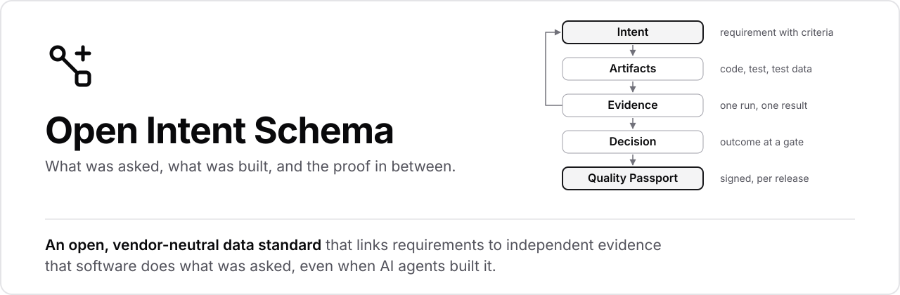

<p>
<picture>
  <source media="(prefers-color-scheme: dark)" srcset="assets/banner-dark.svg">
  
</picture>
</p>

<br>

<a href="https://openintentschema.io/specification/"></a>
<a href="https://pypi.org/project/ois-tools/"></a>
<a href="https://www.npmjs.com/package/ois-tools"></a>
<a href="https://github.com/openintentschema/openintentschema/blob/main/LICENSE"></a>

---

| [**Website →**](https://openintentschema.io) | [**Getting started →**](https://openintentschema.io/getting-started/) | [**Specification →**](https://openintentschema.io/specification/) | [**Open RFCs →**](https://github.com/openintentschema/openintentschema/issues?q=label%3Arfc) |
|---|---|---|---|
| Overview and documentation | First records in 15 minutes | v0.1, working draft | Proposed changes, open for comment |

---

## What is OIS?

Think of it as an **SBOM for requirements**: an SBOM lists what software contains; OIS states what it must do and how that is proven.

OIS records intents and their acceptance criteria, the artifacts produced, who or what produced them and with which context, the evidence from test runs, the decisions at quality gates, and the findings when something goes wrong. A signed **Quality Passport** bundles all of it for a release.

> [!NOTE]
> Specification v0.1 is a working draft, open for discussion with design partners. Any part may change before 1.0.

## Try it in 15 minutes

Turn the JUnit XML of an existing pipeline into OIS records:

```sh
pip install ois-tools
```

Then follow **[Getting started →](https://openintentschema.io/getting-started/)**

## Repositories

| Repository | What's inside | Get it |
|---|---|---|
| [**openintentschema**](https://github.com/openintentschema/openintentschema) | Specification, JSON Schema, conformance fixtures, profiles, website | [openintentschema.io](https://openintentschema.io) |
| [**tools**](https://github.com/openintentschema/tools) | Reference CLI `ois`: validator, test report adapters, passports, signing (Python; the container image runs it in projects of any language) | [PyPI](https://pypi.org/project/ois-tools/) · [Docker](https://github.com/orgs/openintentschema/packages/container/package/ois-tools) |
| [**tools-js**](https://github.com/openintentschema/tools-js) | Second validator implementation (Node.js) | [npm](https://www.npmjs.com/package/ois-tools) |

## Conformance levels

| Level | | A producer at this level |
|:---:|---|---|
| **1** | **Observe** | emits records for its existing outputs |
| **2** | **Intent-aware** | reads intents and records complete context |
| **3** | **Attested** | signs bundles and passports under a verifiable identity |

## Built on open standards

Gherkin · EARS · in-toto · DSSE · Sigstore · SLSA · CloudEvents · W3C Trace Context · JSON Schema 2020-12 · RFC 8785

## Get involved

- **Propose a change.** Changes to the data model, rules, schema or passport format start as an [RFC issue](https://github.com/openintentschema/openintentschema/issues?q=label%3Arfc).
- **Contribute.** Read the [contributing guide](https://github.com/openintentschema/openintentschema/blob/main/.github/CONTRIBUTING.md) and how decisions are made in [GOVERNANCE.md](https://github.com/openintentschema/openintentschema/blob/main/GOVERNANCE.md).
- **Become a design partner.** Write to the editors at [editors@openintentschema.io](mailto:editors@openintentschema.io).
- **Report a vulnerability** privately, as described in [SECURITY.md](https://github.com/openintentschema/openintentschema/blob/main/.github/SECURITY.md).

<sub>Schema, code and fixtures: Apache-2.0 · Specification text: CC BY 4.0</sub>
